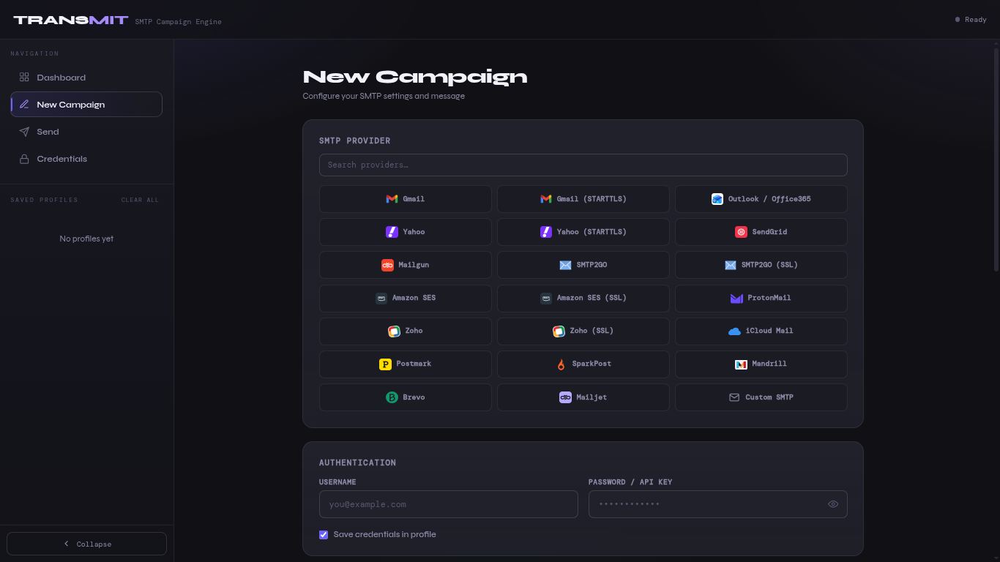

# TRANSMIT — SMTP Campaign Engine

> A dark-themed, cinematic SMTP campaign tool with a full web UI, live send progress, drag-and-drop CSV upload, 20+ SMTP provider support, profile management, and AI-powered email templates.

---

## GUI Dashboard



---

## Installation

**1. Clone the repository**

```bash
git clone https://github.com/blacsecurity/smtp_mailer.git
```

**2. Navigate into the project directory**

```bash
cd smtp_mailer
```

**3. Set up a virtual environment and install dependencies**

**Linux**

```bash
python3 -m venv venv
source venv/bin/activate
pip install -r requirements.txt
```

**macOS**

```bash
python3 -m venv venv
source venv/bin/activate
pip install -r requirements.txt
```

**Windows (PowerShell)**

```powershell
python -m venv venv
venv\Scripts\Activate.ps1
pip install -r requirements.txt
```

---

## Usage

**macOS / Linux**

```bash
python3 smtp_mailer.py
```

**Windows**

```bash
python smtp_mailer.py
```

Once running, open your browser and navigate to:

```
http://localhost:2000
```

---

## Features

- 🖤 Dark cinematic UI with a collapsible sidebar
- 📬 20+ pre-configured SMTP provider chips with official brand logos
- 📁 Drag-and-drop CSV recipient upload
- 💾 Saved sender profiles with create, edit, delete, and clear-all support
- 📡 Live campaign execution with real-time send feedback and stop control
- ✉️ Multipart plain-text + HTML emails for improved inbox deliverability
- 🎭 Sender identity masking (From / Sender / Reply-To)
- 🤖 AI-powered email template generation
- 🔗 Shared `sender_config.json` with CLI interoperability

---

## Project Structure

```
smtp_mailer/
├── smtp_mailer.py        # Main application entry point
├── requirements.txt      # Python dependencies
├── README.md             # Project documentation
├── dashboard.png         # Dashboard screenshot
├── sender_config.json    # Saved SMTP profiles (auto-generated)
└── static/
    ├── index.html        # Single-page web UI (HTML, CSS, JS)
    └── smtpmailer.png    # App logo / asset
```

---

## License

MIT © [blacsecurity](https://github.com/blacsecurity)
